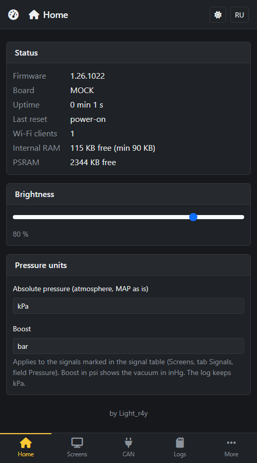
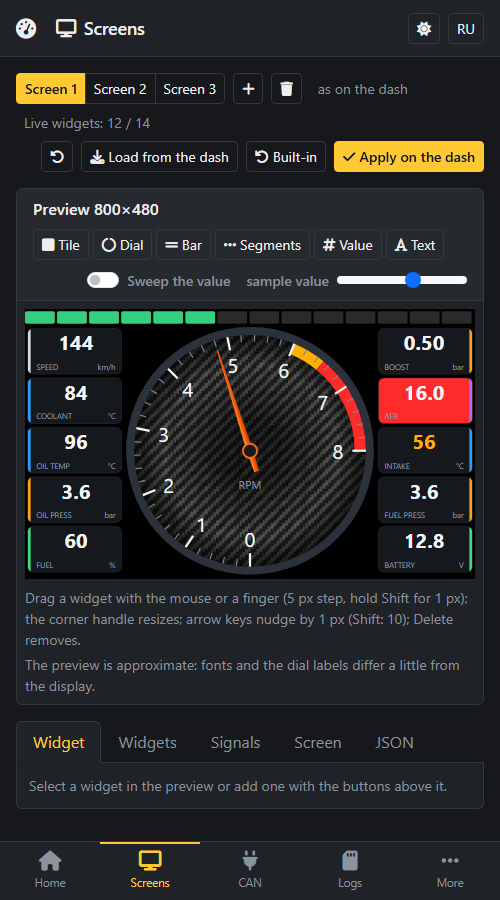
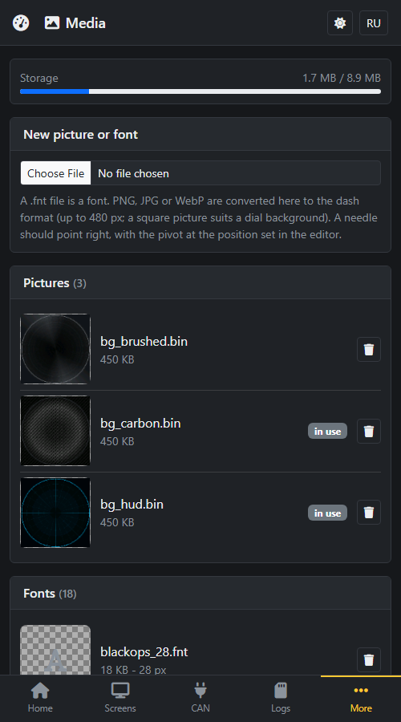
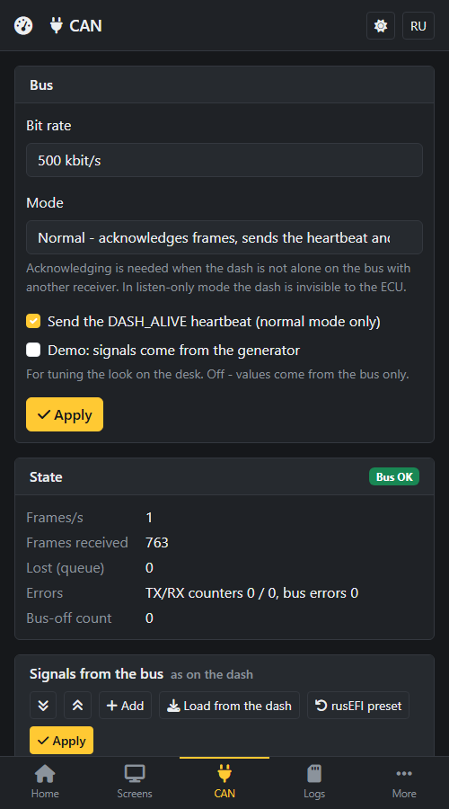
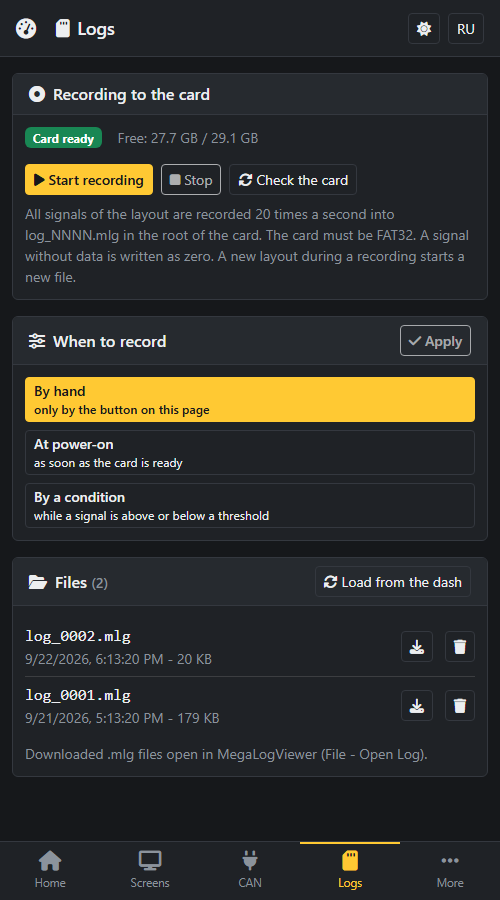
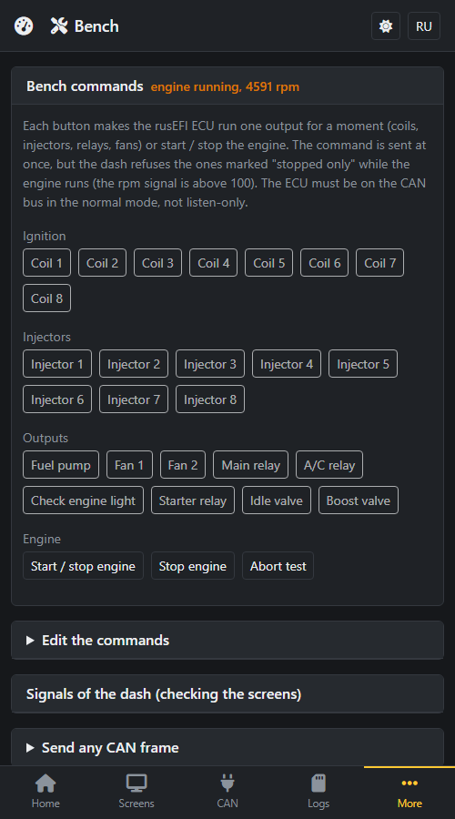

# nDash — CAN dashboard for rusEFI on ESP32-S3

**English** | [Русский](README_ru.md)

[](https://www.espressif.com/en/products/socs/esp32-s3)
[](https://github.com/espressif/esp-idf)
[](https://lvgl.io)

Firmware for a car dashboard on 800×480 RGB touch screens with an ESP32-S3: data comes from the CAN bus
of a [rusEFI](https://rusefi.com/) ECU (it can be set up for any CAN source if the signal layout is known), what to show and how is configured from a web page over Wi-Fi,
and screens are switched with swipes.

> **Working prototype.** Main test board: Waveshare ESP32-S3-Touch-LCD-7.

> **Looking for uaDASH?** The previous project (Arduino firmware, SquareLine UI, connector adapter, build instructions for
> the supported boards) now lives in the [`v1` branch](https://github.com/Light-r4y/uaDASH/tree/v1). This branch is nDash.

## Features

| | What |
|---|---|
| 🖥️ | 800×480 RGB panel, LVGL 9, two frame buffers in PSRAM, no tearing |
| 🎨 | Three ready screens out of the box (main, tuning, drive; the generator is `tools/mk_default_layout.py`). Screens built from a JSON layout: dials (background picture, needle line or picture, ticks, pivot), tiles, numbers, text, bars, segment strips; colours of a tile (background / accent / border) can follow the zone of its signal; a zone has a "panel" flag: a red limit fills the panel, an amber warning only colours the number |
| 🔤 | 18 fonts of the RD set (Orbitron, Michroma, Russo One, Jura, Black Ops One, Segment7) flashed to the media partition; your own fonts and pictures are uploaded on the "Media" page |
| 📏 | Pressure units on the Home page: absolute pressure kPa / inHg, boost bar / psi (vacuum in inHg); a signal opts in with the "Pressure" field of the signal table |
| 👆 | GT911 touch: swipe left/right switches screens, brightness is remembered |
| 🚌 | CAN (TWAI) reception with the rusEFI preset, signal table with zones and timeouts, web sniffer, demo generator |
| 🧪 | **Bench**: rusEFI test commands from the web (coils, injectors, fuel pump, fans, relays, engine start/stop); sent at once, but refused while the engine is running; the table is editable |
| 💾 | **Log** to microSD in the MegaLogViewer format (`.mlg`), 20 Hz, all layout signals; start manually, at power-on or by a condition; download and delete on the "Logs" page |
| 📶 | Wi-Fi access point on a long press of the button; the web interface is phone-friendly (tab bar), RU/EN |
| 🔄 | Firmware and web-interface update via `/ota`, rollback of a failed update |

## What it looks like

The three screens that come with the firmware (before you change anything). These are not photos of the board but a
render of the layout.

<p align="center">
  
</p>

A red zone fills the panel of a tile, an amber one colours the number; the limits are examples, set your own on the
"Signals" tab of the editor. The web interface is made for a phone first (the pictures are the mock server at 500 px width):
Home, Screens (the editor with a preview), Media, CAN, Logs, Bench.

<p align="center">
  
  
</p>

## Hardware

Four boards are supported (`NDASH_BOARD`):

| Board | `NDASH_BOARD` | Notes |
|---|---|---|
| Waveshare ESP32-S3-Touch-LCD-7 | `WAVESHARE_S3_LCD7` | main test board; IO expander CH422G |
| Waveshare ESP32-S3-Touch-LCD-5 (800×480) | `WAVESHARE_S3_LCD5` | CH422G |
| JC8048W550C 5" | `JC8048W550C` | not tested on hardware; SD pins not checked against the schematic |
| Sunton ESP32-S3 LCD7 | `Sunton_S3_LCD7` | not tested on hardware; SD pins not checked against the schematic |

ESP32-S3 with **octal PSRAM** is required (the frame buffers do not fit into internal RAM).

- **CAN transceiver**: 3.3 V (SN65HVD230 or TJA1051T/3) on the CAN pins of the board; on the Waveshare 7" the
  board already has one, the pins are `LND_CAN_RX_PIN` / `LND_CAN_TX_PIN` in `common/board/board.h`.
- **microSD**: FAT32 only (exFAT cards, for example 128 GB ones, are not mounted — format them as FAT32).
- **Power** in the car: a 12→5 V DC-DC converter with surge protection.

### External button for the access point

The firmware reads one button (`lnd_board_btn_pressed()`, pin `LND_BTN_BOOT_PIN`, GPIO0): hold 2 s — access
point, hold 10 s — clear a forgotten settings password. An external button is wired **between the pin and
GND** (the pin is pulled up inside); it can be put in parallel with BOOT. The GPIO of the button is set on the Home page of the web interface (card "Button", 0 by
default - BOOT); the firmware refuses the pins the board itself uses.

Free pins of the **Waveshare 7"** (by `board.h`; the header pins must still be checked against the Waveshare
schematic before soldering):

| GPIO | Status | Comment |
|---|---|---|
| 15 | candidate | not used by the firmware; on the sibling 7B board it is the RS-485 TX, so it only feeds a transceiver input and a button to GND does no harm |
| 16 | possible | RS-485 RX on the 7B: the transceiver drives it, a button would fight it |
| 4 | avoid | presumably the touch INT line of the GT911 (not used by the firmware, but wired) |
| 43 / 44 | avoid | UART0 (console, `NDASH_CONSOLE=uart`) |
| 0 | caution | BOOT, but in `board.h` it is also the RGB data line G1 of the panel; do not hold it at power-on (download mode) |
| 35–37 | no | octal PSRAM |

All other GPIOs are taken by the RGB panel, touch I2C (8/9), CAN (19/20), backlight (6) and the SD card
(11/12/13, CS on the CH422G EXIO4).

## Layout

```
main/            initialisation, task start
tasks/
  can/           TWAI node, rusEFI frames to signals, bench frames
  ui/            LVGL task, screens from the layout, fonts, images, FPS overlay
  touch/         GT911 polling, swipes
  buttons/       the button: access point, password reset
  webcfg/        Wi-Fi AP, HTTP server, REST API, OTA
  logger/        microSD log (MLG)
common/
  board/         pins and timings of the boards, I2C, CH422G, backlight, RGB panel, SD
  config/        conf.h (all constants), layout, settings, bench commands, auth
  signals/       signal store (values, zones, timeouts), demo generator
  media/         media partition (pictures, fonts)
www/             web interface (packed and gzipped into the firmware by tools/pack_www.py)
media/           base set flashed to the media partition: backgrounds and fonts
tools/           release script, web packer, mock server
```

## Requirements

- ESP-IDF **v6.0** (v5.1+ should work), target `esp32s3`
- Python 3 (build and release scripts), a USB cable to the board

## Quick start

### Ready firmware (release)

1. Download the archive of your board, `nDash-v<version>-<BOARD>.zip`, from the project releases and unpack it.
2. Connect the board by USB. If it does not show up as a COM port, connect it with the BOOT button held and release the
   button after a couple of seconds.
3. Run `install.bat` (Windows) or `install.sh` (Linux / macOS, only Python 3 is needed): the script finds the port and
   flashes everything. Your saved settings, layout and CAN tables stay; pictures uploaded on the web are replaced by the
   built-in ones.

Update later with `update.bat` / `update.sh` (only the application and the web interface change, everything saved stays)
or without a cable from the `/ota` page. How the releases are made: see "Release build" below.

### Build from source

The board is chosen at build time, there is no default:

```bash
idf.py set-target esp32s3
idf.py -D NDASH_BOARD=WAVESHARE_S3_LCD7 build
idf.py -p COM9 flash monitor
```

> 💡 **Windows:** `. "$env:USERPROFILE\esp\v6.0\esp-idf\export.ps1"` in PowerShell first. On the Waveshare 7"
> the USB pins are the CAN pins, so the console is a UART (`NDASH_CONSOLE=uart`, the default on that board).

### First run

1. **Hold the button for two seconds** — the screen shows the network name, the password and the address.
2. Join the network from a phone and open `http://192.168.4.1/`.
3. **CAN** → turn on **Demo** → Apply: the values start moving.
4. **Screens** — the layout editor with a preview; **Media** — pictures and fonts; **Logs** — microSD
   recording; **Bench** — test commands; **Access** — the settings password and the Wi-Fi name and password.

### Controls

| Action | Result |
|---|---|
| Swipe left / right | next / previous screen |
| Button, short press | brightness cycle: 100 → 60 → 30 → 10 → 100 % (remembered; the Waveshare 5" has no brightness control) |
| Button, hold 2 s | Wi-Fi access point |
| Button, hold 10 s | clear a forgotten settings password (a warning comes first) |

### Build options (`idf.py -D NAME=value build`)

| Option | Values | Default | What |
|---|---|---|---|
| `NDASH_BOARD` | see Hardware | required | pins and timings |
| `NDASH_DEMO` | `1` / `0` | `0` | values sweep through the whole range without an ECU |
| `NDASH_UI_SHOW_FPS` | `1` / `0` | `1` | fps overlay (off in release builds) |
| `NDASH_CONSOLE` | `uart` / `usb` | board-specific | where the log goes |
| `NDASH_LAYOUT_BUILTIN` | `1` / `0` | `1` | built-in layout when none is stored |
| `NDASH_LOG_LEVEL` | `info` / `warn` | `info` | firmware log level (releases use `warn`) |

## Graphics limits

Rendering is software, the frame buffers are in PSRAM, so the cost of an element is the number of repainted
pixels. The panel clock (12 MHz on the LCD7) caps the rate at about 30 fps. To keep it comfortable the firmware
and the editor reject a screen with:

- more than **14 live widgets** (tile, number, dial, bar, segments; static text is free);
- more than **2 dials**;
- a *number* or *text* widget over a dial (use a tile or the dial's own value and caption).

Measured in demo mode (all values moving): 16 tiles — 30 fps; one 440 px dial with a background — 30 fps; the
built-in screen (dial + 8 tiles + segments) — 21 fps; with a needle picture — 15–17 fps. A needle picture is the
most expensive element. Details and the table are in [README_ru.md](README_ru.md#производительность-отрисовки).

## rusEFI output test (bench)

The "Bench" page sends rusEFI `ECU_CAN_BUS_USER_CONTROL` frames (extended ID `0x77000C`, data `66 00`,
subsystem, index). The preset follows the rusEFI sources (coils `0x12`, injectors `0x13`, start/stop `0x14`,
outputs `0x16`, stop engine `0x24`); numbering can differ in an old ECU firmware, so the table is editable
(stored in NVS, "rusEFI preset" restores it). Commands marked "stopped only" are refused with HTTP 409 while
`rpm` is above 100.

## Log

`tasks/logger` writes all layout signals at 20 Hz to `log_NNNN.mlg` in the root of a FAT32 card (open them in
MegaLogViewer). Start: manually, at power-on, or while a signal is above/below a threshold (plus a stop delay).
Writing stops on a card error and when less than 4 MB is left. The board has no battery clock, so the Logs page
sends the browser time when it opens. SPI pins: MOSI 11, SCK 12, MISO 13, CS GPIO10 or CH422G EXIO4 (Waveshare).

## Release build

```bash
python tools/build_release.py            # Waveshare 7" and 5" (tried on hardware), ~15 minutes
python tools/build_release.py WAVESHARE_S3_LCD7
```

Output goes to `release/`: per board OTA images, install/update scripts, a manifest with SHA-256. The version is
`1.<YY>.<MMDD>` (the build date), written to `version.txt`. See [tools/README.md](tools/README.md).

## Web interface without hardware

```bash
python tools/webtest/mock_server.py
```

Open `http://localhost:8088/`: the server serves `www/` and emulates the board's API (layout, CAN, bench, logs,
media).

## Known limitations

- Pins of the SD card on JC8048W550C and Sunton boards are not checked against the schematics.
- exFAT cards are not supported; FAT32 only.
- With the access point up only about 24 KB of internal RAM stay free: do not raise buffers in `sdkconfig.defaults`
  without measuring.
- The CH422G register model is written after a third-party library; the Waveshare boards are the tested ones.

## Third-party code

| What | License |
|---|---|
| [LVGL](https://lvgl.io) 9, ESP-IDF and Espressif components (fetched at build time) | MIT / Apache-2.0 |
| [Bootstrap](https://getbootstrap.com) 5.3, [Font Awesome Free](https://fontawesome.com) in `www/` | MIT, icons CC BY 4.0, font SIL OFL 1.1 |
| Orbitron, Michroma, Russo One, Jura (Google Fonts), Black Ops One (slanted 24°), Segment7 (Cedders) as LVGL fonts, from roundGauge | SIL OFL 1.1 |
| Backgrounds `bg_brushed`, `bg_carbon`, `bg_hud` in `media/` | see roundGauge |

## License

See [LICENSE](LICENSE). Footer of the web interface: by Light_r4y.
