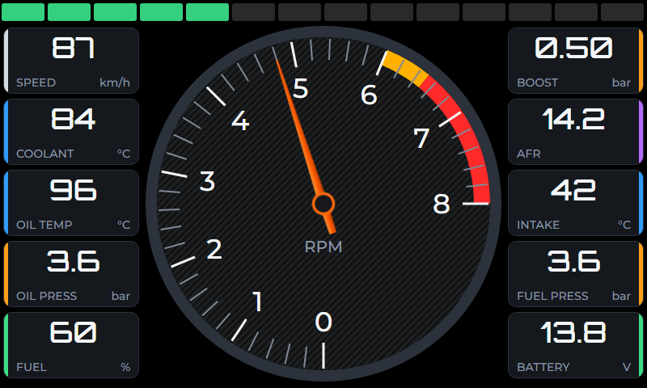
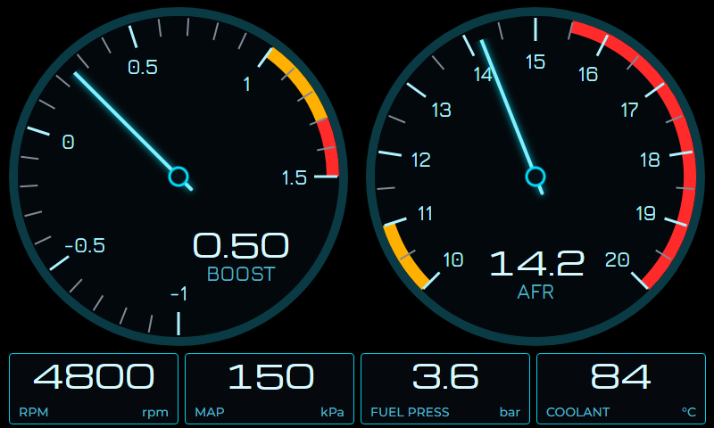
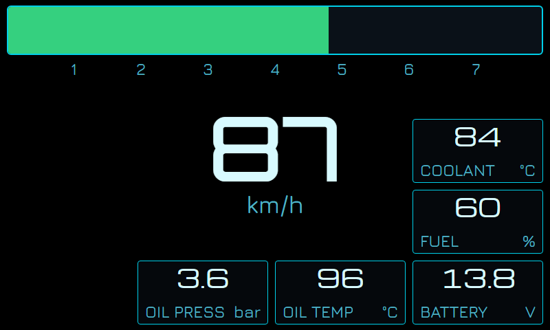
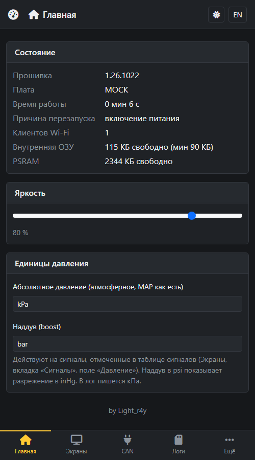
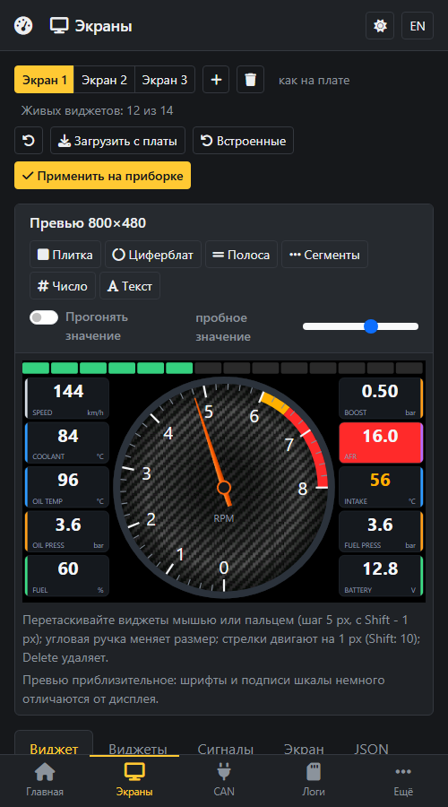
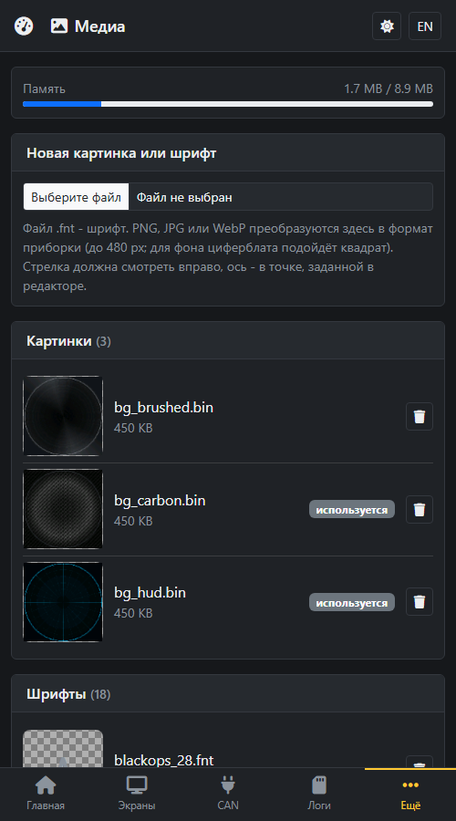
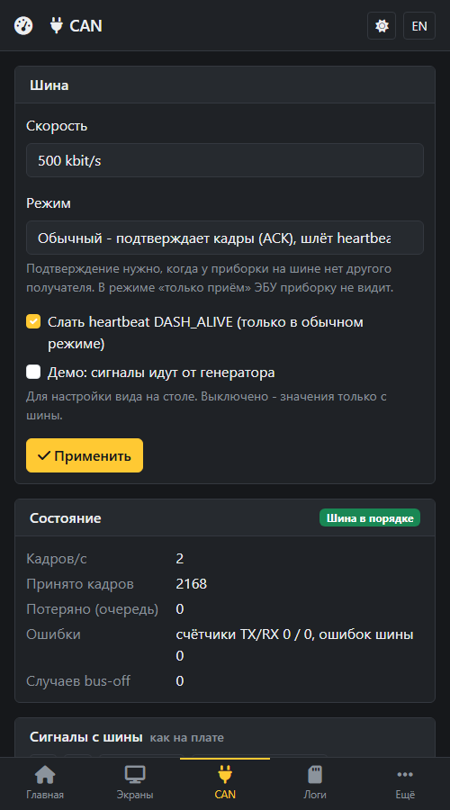
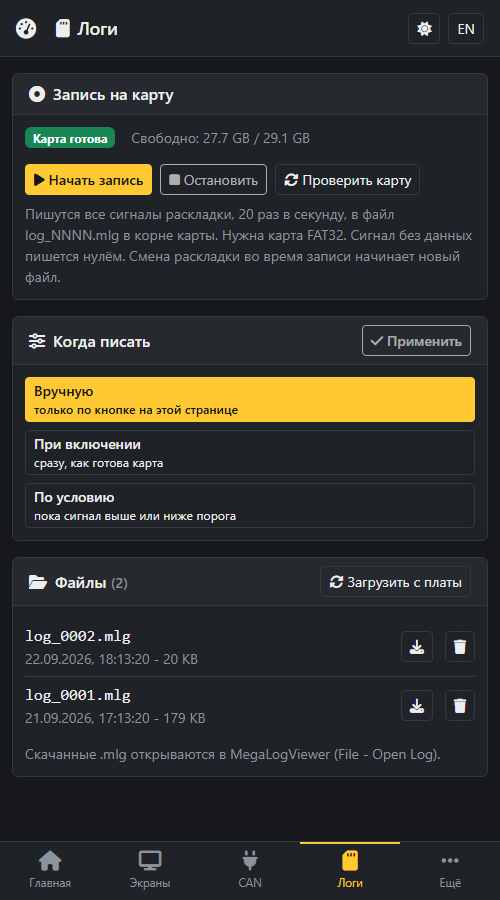
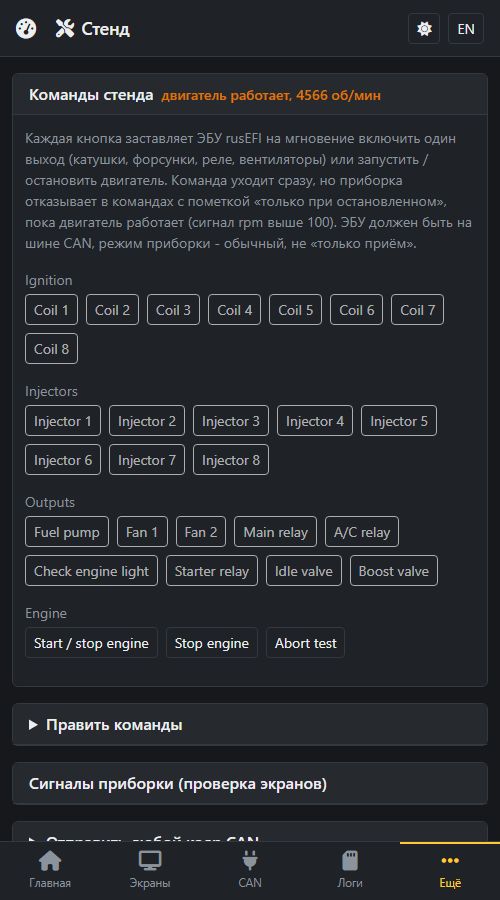

# nDash — CAN-приборная панель для rusEFI на ESP32-S3

[English](README.md) | **Русский**

[](https://www.espressif.com/en/products/socs/esp32-s3)
[](https://github.com/espressif/esp-idf)
[](https://lvgl.io)

Прошивка приборной панели на RGB-экранах 800×480 с тачем на ESP32-S3: данные приходят по CAN от ЭБУ
[rusEFI](https://rusefi.com/) (можно настроить под любой CAN если известна раскладка сигналов); что и как показывать - настраивается с веб-страницы по Wi-Fi, экраны переключаются свайпами.

> **Рабочий прототип.** Основная тестовая плата: Waveshare ESP32-S3-Touch-LCD-7.

> **Ищете uaDASH?** Прежний проект (прошивка на Arduino, интерфейс SquareLine, плата-адаптер, инструкции по сборке для
> поддерживаемых плат) теперь находится в [ветке `v1`](https://github.com/Light-r4y/uaDASH/tree/v1). В этой ветке - nDash.

## Возможности

| | Что |
|---|---|
| 🖥️ | RGB-панель 800×480, LVGL 9, два кадровых буфера в PSRAM, без разрывов кадра |
| 🎨 | Три готовых экрана из коробки (главный, тюнинг, город; генератор - `tools/mk_default_layout.py`). Экраны из JSON-раскладки: циферблаты (фон-картинка, стрелка-линия или картинка, шкала, ось), плитки, числа, текст, полосы, сегменты; цвета плитки (фон / акцент / рамка) могут следовать зоне её сигнала; у зоны есть признак «фон»: красный предел заливает фон плитки, жёлтое предупреждение красит только число |
| 🔤 | 18 шрифтов набора RD (Orbitron, Michroma, Russo One, Jura, Black Ops One, Segment7) в разделе media; свои шрифты и картинки загружаются на странице «Медиа» |
| 📏 | Единицы давления на главной странице: абсолютное кПа / inHg, наддув bar / psi (разрежение в inHg); сигнал включается полем «Давление» в таблице сигналов |
| 👆 | Тач GT911: свайп влево/вправо переключает экраны, яркость запоминается |
| 🚌 | Приём CAN (TWAI) с пресетом rusEFI, таблица сигналов с зонами и таймаутами, веб-сниффер, генератор демо |
| 🧪 | **Стенд (bench)**: тестовые команды rusEFI из веба (катушки, форсунки, насос, вентиляторы, реле, пуск/останов); уходят сразу, но отклоняются при работающем двигателе; таблица редактируется |
| 💾 | **Лог** на microSD в формате MegaLogViewer (`.mlg`), 20 Гц, все сигналы раскладки; вручную, при включении или по условию; скачивание и удаление на странице «Логи» |
| 📶 | Точка доступа Wi-Fi по долгому нажатию кнопки; веб-интерфейс удобен на телефоне (нижняя панель вкладок), RU/EN |
| 🔄 | Обновление прошивки и веб-части через `/ota`, откат неудачного обновления |

## Как это выглядит

Три экрана, которые идут с прошивкой (пока вы ничего не меняли). Это не фото платы, а отрисовка раскладки.

<p align="center">
  
</p>

Красная зона заливает фон плитки, жёлтая красит число; пределы примерные, свои задаются на вкладке «Сигналы» редактора.
Веб-интерфейс сделан в первую очередь под телефон (на картинках мок-сервер при ширине 500 px): Главная, Экраны (редактор с
предпросмотром), Медиа, CAN, Логи, Bench.

<p align="center">
  
  
</p>

## Железо

Поддерживаются четыре платы (`NDASH_BOARD`); на плате JC8048W550C 5" и на Sunton прошивка не проверялась:

| Плата | `NDASH_BOARD` | Примечание |
|---|---|---|
| Waveshare ESP32-S3-Touch-LCD-7 | `WAVESHARE_S3_LCD7` | основная тестовая; расширитель CH422G |
| Waveshare ESP32-S3-Touch-LCD-5 (800×480) | `WAVESHARE_S3_LCD5` | CH422G |
| JC8048W550C 5" | `JC8048W550C` | выводы SD не сверены со схемой |
| Sunton ESP32-S3 LCD7 | `Sunton_S3_LCD7` | выводы SD не сверены со схемой |

Нужен ESP32-S3 с **октальным PSRAM** (кадровые буферы не помещаются во внутреннюю RAM).

- **CAN-трансивер** 3,3 В (SN65HVD230 или TJA1051T/3) на выводах CAN платы; на Waveshare 7" он уже есть, выводы -
  `LND_CAN_RX_PIN` / `LND_CAN_TX_PIN` в `common/board/board.h`.
- **microSD**: только FAT32 (карты exFAT, например на 128 ГБ, не монтируются - отформатируйте в FAT32).
- **Питание** в автомобиле: понижающий DC-DC 12→5 В с защитой от выбросов.

### Выносная кнопка точки доступа

Прошивка читает одну кнопку (`lnd_board_btn_pressed()`, вывод `LND_BTN_BOOT_PIN`, GPIO0): удержание 2 с - точка
доступа, 10 с - сброс забытого пароля настроек. Внешняя кнопка включается **между выводом и GND** (подтяжка к
питанию внутри), её можно подключить параллельно BOOT. Вывод кнопки меняется на главной странице веб-интерфейса (карточка
«Кнопка», по умолчанию 0 - BOOT); занятые платой выводы прошивка не принимает.

Свободные выводы **Waveshare 7"** (по `board.h`; перед пайкой разводку на гребёнке всё равно сверьте со схемой Waveshare):

| GPIO | Статус | Комментарий |
|---|---|---|
| 15 | кандидат | прошивкой не используется; на родственной 7B это TX RS-485, то есть выход к входу трансивера - кнопка на GND не мешает |
| 16 | возможно | на 7B это RX RS-485: его драйвит трансивер, кнопка будет с ним конфликтовать |
| 4 | избегать | предположительно линия INT тача GT911 (прошивка её не использует, но она подключена) |
| 43 / 44 | избегать | UART0 (консоль, `NDASH_CONSOLE=uart`) |
| 0 | осторожно | BOOT, но в `board.h` это ещё и линия данных G1 RGB-панели; не держать при включении питания (режим загрузки) |
| 35–37 | нельзя | октальный PSRAM |

Остальные GPIO заняты RGB-панелью, I2C тача (8/9), CAN (19/20), подсветкой (6) и картой SD (11/12/13, CS на EXIO4 CH422G).

## Структура

```
main/            инициализация, запуск задач
tasks/
  can/           узел TWAI, кадры rusEFI в сигналы, кадры bench
  ui/            задача LVGL, экраны из раскладки, шрифты, картинки, оверлей fps
  touch/         опрос GT911, свайпы
  buttons/       кнопка: точка доступа, сброс пароля
  webcfg/        точка доступа Wi-Fi, HTTP-сервер, REST API, OTA
  logger/        лог на microSD (MLG)
common/
  board/         выводы и тайминги плат, I2C, CH422G, подсветка, RGB-панель, SD
  config/        conf.h (все константы), раскладка, настройки, команды bench, авторизация
  signals/       хранилище сигналов (значения, зоны, таймауты), генератор демо
  media/         раздел media (картинки, шрифты)
www/             веб-интерфейс (пакуется и сжимается в прошивку tools/pack_www.py)
media/           базовый набор для раздела media: фоны и шрифты
tools/           релизный скрипт, упаковщик веба, мок-сервер
```

Чистый C, функции `lnd_*`, макросы `LND_*`. Источники (CAN) пишут значения в хранилище сигналов, виджеты читают их по
имени; сигнал без свежих данных показывается как `--`. К объектам LVGL из других задач можно обращаться только под
`lvgl_port_lock(0)` / `lvgl_port_unlock()`.

## Требования

- ESP-IDF **v6.0** (v5.1+ должен работать), таргет `esp32s3`
- Python 3 (скрипты сборки и релиза), USB-кабель к плате

## Быстрый старт

### Готовая прошивка (релиз)

1. Скачайте архив своей платы `nDash-v<версия>-<ПЛАТА>.zip` из релизов проекта и распакуйте его.
2. Подключите плату по USB. Если она не определяется как COM-порт, подключите её с зажатой кнопкой BOOT и отпустите кнопку
   через пару секунд.
3. Запустите `install.bat` (Windows) или `install.sh` (Linux / macOS, нужен только Python 3): скрипт сам найдёт порт и
   прошьёт всё. Сохранённые настройки, раскладка и таблицы CAN остаются, картинки из веба заменяются встроенными.

Позже обновляйтесь скриптом `update.bat` / `update.sh` (меняет только приложение и веб, всё сохранённое остаётся) или без
кабеля со страницы `/ota`. Как собираются релизы - в разделе «Релизная сборка».

### Сборка из исходников

Плата выбирается при сборке, значения по умолчанию нет:

```bash
idf.py set-target esp32s3
idf.py -D NDASH_BOARD=WAVESHARE_S3_LCD7 build
idf.py -p COM9 flash monitor
```

> **Windows:** сначала в PowerShell `. "$env:USERPROFILE\esp\v6.0\esp-idf\export.ps1"`. На Waveshare 7" выводы USB заняты
> под CAN, поэтому консоль - UART (`NDASH_CONSOLE=uart`, на этой плате по умолчанию).


### Первый запуск

1. **Удерживайте кнопку две секунды** - на экране появятся имя сети, пароль и адрес.
2. Подключитесь к сети с телефона и откройте `http://192.168.4.1/`.
3. **CAN** → включите **Демо** → Применить: значения оживут.
4. **Экраны** - редактор раскладки с предпросмотром; **Медиа** - картинки и шрифты; **Логи** - запись на microSD;
   **Bench** - тестовые команды; **Доступ** - пароль настроек, имя и пароль Wi-Fi.

### Управление

| Действие | Результат |
|---|---|
| Свайп влево / вправо | следующий / предыдущий экран |
| Кнопка, короткое нажатие | яркость по кругу: 100 → 60 → 30 → 10 → 100 % (запоминается; на Waveshare 5" регулировки яркости нет) |
| Кнопка, удержание 2 с | точка доступа Wi-Fi |
| Кнопка, удержание 10 с | сброс забытого пароля настроек (сначала предупреждение) |

### Опции сборки (`idf.py -D ИМЯ=значение build`)

| Опция | Значения | По умолчанию | Что делает |
|---|---|---|---|
| `NDASH_BOARD` | см. «Железо» | обязательна | выбор выводов и таймингов |
| `NDASH_DEMO` | `1` / `0` | `0` | значения плавно гоняются по всему диапазону без ЭБУ |
| `NDASH_UI_SHOW_FPS` | `1` / `0` | `1` | оверлей fps (в релизах выключен) |
| `NDASH_CONSOLE` | `uart` / `usb` | по плате | куда идёт лог |
| `NDASH_LAYOUT_BUILTIN` | `1` / `0` | `1` | встроенная раскладка, если сохранённой нет |
| `NDASH_LOG_LEVEL` | `info` / `warn` | `info` | уровень лога прошивки (в релизах `warn`) |

Параметры задач (стеки, приоритеты, периоды) - в `common/config/conf.h`, выводы и тайминги RGB-шины - в `common/board/board.h`.

## Производительность отрисовки

Измерения для `WAVESHARE_S3_LCD7`, 800x480. Рендер LVGL программный, кадровые буферы в PSRAM, код тоже исполняется из
PSRAM, поэтому цена элемента - в основном число перерисованных пикселей. Потолок кадров задаёт частота панели (12 МГц,
около 30 Гц). Что сделано для скорости:

- число в плитке - непрозрачная метка в цвет панели без запаса на наклонные глифы: LVGL перерисовывает только её,
  а не экран, скруглённую панель и рамку под ней (плитка стала дешевле примерно вдвое);
- фон экрана рисуется как обычно (прозрачный экран не годится: LVGL тогда заливает нижний слой белым);
- числа обновляются не чаще 10 Гц и не более 3 за проход (`LND_NUMBER_UPDATE_MS`, `LND_NUMBERS_PER_UPDATE`),
  поэтому стрелка двигается плавно при любом числе плиток;
- кэши 32 КБ (инструкции) и 64 КБ (данные): рендер быстрее примерно на четверть, за 48 КБ внутренней RAM.

Замеры в режиме демо (`NDASH_DEMO=1`, все значения меняются), нагрузка = доля времени на рендер:

| Экран | fps | нагрузка |
|---|---|---|
| 4 / 8 / 12 / 16 плиток | 21 / 30 / 30 / 30 | 4 / 9 / 15 / 20 % |
| 16 плиток + полоса сегментов | 30 | 20 % |
| Циферблат 440 px, стрелка-линия | 30 | 35 % |
| Циферблат 440 px + фон-картинка, стрелка-линия | 30 | 44 % |
| Циферблат 440 px + фон + стрелка-картинка | 17 | 44 % |
| Встроенный экран (циферблат + 8 плиток + сегменты + скорость в центре) | 21 | 34 % |
| То же, с фоном | 19 | 38 % |
| То же, с фоном и стрелкой-картинкой | 15 | 48 % |
| Два циферблата по 380 px + 2 плитки, стрелки-линии | 29 | 37 % |
| То же с фоном-картинкой | 26 | 42 % |
| То же с фоном и стрелками-картинками | 15 | 48 % |

Стрелка-картинка - самое дорогое: она перерисовывает прямоугольник вокруг поворота (до 270x270 px).
Прозрачные метки поверх циферблата (скорость в центре) тоже дороги: под ними перерисовываются диск, шкала и фон.

### Ограничения раскладки

Чтобы кадровая частота оставалась комфортной, прошивка (`lnd_layout_check`) и редактор не принимают экран, где:

- больше 14 «живых» виджетов (плитка, число, циферблат, полоса, сегменты; статичный текст не считается, `LND_LAYOUT_MAX_LIVE`);
- больше двух циферблатов (`LND_LAYOUT_MAX_DIALS`);
- виджет «число» или «текст» лежит поверх циферблата: у них нет своего фона, и под ними при каждом изменении
  перерисовывались бы диск, шкала и картинка. Вместо этого используйте плитку или собственные число и подпись циферблата.

Редактор показывает счётчик «Живых виджетов», отменяет правку, нарушающую предел, и не даёт применить такую раскладку;
`POST /api/layout` отвечает 400 с причиной. Раскладка, уже сохранённая в NVS, читается как есть.

## Проверка каналов управления (bench) rusEFI

Страница `/bench.html` - кнопки, которые заставляют ЭБУ rusEFI на мгновение включить выход (катушки, форсунки,
топливный насос, вентиляторы, реле, клапаны) или запустить / остановить двигатель. Кадр - расширенный ID `0x77000C`
(`ECU_CAN_BUS_USER_CONTROL`), данные `0x66 0x00`, подсистема (2 байта), индекс (2 байта), нули до DLC 6 или 8.
Пресет (`common/config/bench_cmds.c`) собран по исходникам rusEFI (`ts_command_e`, `bench_mode_e`): катушки `0x12`,
форсунки `0x13`, запуск / остановка `0x14` индекс 9, выходы `0x16` (насос 1, вентиляторы 4 и 5, главное реле 0, A/C 6,
лампа check engine 7, стартёр 2, клапан ХХ 8, наддув 43, отмена 15), остановка двигателя `0x24`. Нумерация - по
текущему master; в старой прошивке ЭБУ она может отличаться, поэтому таблицу можно править на самой странице
(хранится в NVS, кнопка «Пресет rusEFI» возвращает встроенную).

Команда с пометкой «только при остановленном» (по умолчанию все, кроме запуска / остановки и отмены) уходит сразу, но
приборка её отклоняет (HTTP 409), пока сигнал `rpm` выше `LND_BENCH_RUNNING_RPM` (100); нет сигнала - считается, что
двигатель стоит. Отправка работает только в обычном режиме CAN (в «только приём» приборка ничего не передаёт).
Ниже на той же странице - проверка самой приборки: живые сигналы с ползунками (значение закрепляется на
`LND_BENCH_HOLD_MS` после последнего запроса), включение демо и отправка произвольного кадра.

## Лог на microSD

Страница `/logs.html` и задача `tasks/logger` (перенесены из roundGauge): все сигналы текущей раскладки пишутся
20 раз в секунду на карту FAT32 в формате MegaLogViewer (`log_NNNN.mlg` в корне, поля - имена и единицы сигналов,
сигнал без данных пишется нулём, смена раскладки начинает новый файл). Условия записи (хранятся в настройках, `log`):

- **вручную** - кнопки на странице;
- **при включении** - как только готова карта;
- **по условию** - пока сигнал выше или ниже порога и ещё `stop_delay` секунд после.

Запись останавливается при ошибке карты и при остатке меньше 4 МБ. Файлы можно скачать и удалить на странице. У платы
нет часов с питанием, поэтому страница при открытии присылает время браузера (даты файлов и метка в заголовке).

Выводы карты (`common/board/board.h`): MOSI 11, SCK 12, MISO 13; CS - ножка 10 (JC8048W550C, Sunton) или выход
EXIO4 расширителя CH422G (Waveshare, он держится низким, пока карта примонтирована). Для Waveshare 7" и 5" они взяты из
документации платы; для JC8048W550C и Sunton выводы не сверены со схемами - проверьте на первой карте.
Задача логгера на ядре 0 (приоритет 2), стек 6 КБ, буфер записи 4 КБ; SPI-шина карты отдельная от панели и касания.

## Шрифты и медиа

Шрифты Orbitron, Michroma, Russo One, Jura (Google Fonts), Black Ops One (с наклоном контуров 24°) и Segment7
(Cedders, 2014) лежат в `media/*.fnt` в формате LVGL bin (взяты из проекта roundGauge, цифры выровнены по ширине) и
прошиваются в раздел media; копии в `tasks/ui/fonts/bin/` вшиты в прошивку как запасные. Файлы `*_56`, `*_64`, `*_96` и
`seg7_*` содержат только цифры и `. : - + % /`. Montserrat встроен в LVGL. Все шрифты - SIL OFL 1.1.

Свои шрифты и картинки загружаются на странице «Медиа»: файл LVGL .fnt (`lv_font_conv --format bin --bpp 4
--no-compress`) или картинка (преобразуется в браузере в LVGL .bin). Файл хранится в разделе media, выбирается по имени
в полях редактора и держится в ОЗУ, пока его использует показанный экран.

## Релизная сборка

```bash
python tools/build_release.py                    # платы Waveshare 7" и 5" (проверенные на железе), около 15 минут
python tools/build_release.py WAVESHARE_S3_LCD7
```

Результат - в `release/`: на каждую плату образы OTA, скрипты установки и обновления, манифест с SHA-256. Версия -
`1.<ГГ>.<ММДД>` (дата сборки), пишется в `version.txt`. Подробнее - [tools/README.md](tools/README.md).

## Веб-интерфейс без железа

```bash
python tools/webtest/mock_server.py
```

Откройте `http://localhost:8088/`: сервер отдаёт `www/` и эмулирует API платы (раскладка, CAN, bench, логи, медиа).

## Известные ограничения

- Выводы SD у плат JC8048W550C и Sunton не сверены со схемами.
- Карты exFAT не поддерживаются, только FAT32.
- При поднятой точке доступа свободно около 24 КБ внутренней RAM: не увеличивайте буферы в `sdkconfig.defaults` без замера.
- Регистровая модель CH422G написана по аналогии с чужой библиотекой; проверены платы Waveshare.
- Пороги предупреждений - цветовые зоны сигналов в раскладке; режима «турбо» нет (MAP показывается в кПа).

## Сторонний код

| Что | Лицензия |
|---|---|
| [LVGL](https://lvgl.io) 9, ESP-IDF и компоненты Espressif (скачиваются при сборке) | MIT / Apache-2.0 |
| [Bootstrap](https://getbootstrap.com) 5.3, [Font Awesome Free](https://fontawesome.com) в `www/` | MIT, иконки CC BY 4.0, шрифт SIL OFL 1.1 |
| Orbitron, Michroma, Russo One, Jura, Black Ops One, Segment7 как шрифты LVGL, из roundGauge | SIL OFL 1.1 |
| Фоны `bg_brushed`, `bg_carbon`, `bg_hud` в `media/` | см. roundGauge |

## Лицензия

См. [LICENSE](LICENSE). Подпись внизу веб-интерфейса: by Light_r4y.
